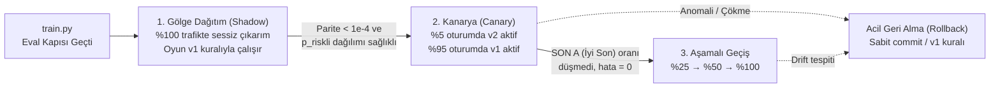

# SE Primer — Model Yayın, Dağıtım Mimarisi ve Sürümleme Rehberi (`RELEASE.md`)

> **Ders:** YZM301 · Yazılım Gerçekleme ve Test — *Modelden Ürüne: Yapay Zekâ (Development · Deployment · Inference)*  
> **Aktif Model Sürümü:** `se-primer-risk-radari v2.0.0` (`model/model.onnx` + `model/config.json`)  
> **3V Odağı (Shankar vd., 2022):** **Velocity** (Tek komutla eğitim ve tarayıcı içi çıkarım), **Validation** (Eval kapısı + Python/Web diferansiyel parite testi $< 10^{-4}$), **Versioning** (Veri SHA-256 + Commit'e sabitlenmiş model URL'si).

---

## 1. Sürüm Geçmişi ve Commit'e Sabitlenmiş Artefakt Yönetimi (Versioning)

Üretim sistemlerinde istemcilerin modeli `main` dalından (`.../resolve/main/model.onnx`) çekmesi, yeni bir model yüklendiğinde istemci sözleşmesinin (özellik sırası, eşik değeri, olasılık kalibrasyonu) habersiz değişmesine ("sessiz bozulma" / silent failure) yol açar (Sommerville, Bl. 25 Konfigürasyon Yönetimi; Breck vd., 2017). Bu nedenle tüm tüketiciler **belirli bir commit özetine (SHA) sabitlenmiş (pinned) URL** kullanır:

```text
https://huggingface.co/ferhatinal/se-primer-risk-radari/resolve/<COMMIT_SHA>/model.onnx
https://huggingface.co/ferhatinal/se-primer-risk-radari/resolve/<COMMIT_SHA>/config.json
```

| Sürüm | Durum | Değişiklik Özeti | Sabitlenen Artefakt / Kaynak |
| :--- | :---: | :--- | :--- |
| **`v1.0.0`** | Kararlı (Yedek) | Sabit kurallı kişiselleştirme: yalnızca girişteki `seviye` seçimine göre ipucu veya 60 sn sayaç açılır. | `git tag v1.0.0` (`b5a556b`) — kural tabanlı motor |
| **`v2.0.0`** | **Aktif Üretim** | Davranıştan öğrenen **Risk Radarı** (`StandardScaler + LogisticRegression → ONNX`, Opset 17). 7 davranış özelliğinden `p_riskli` üretir; `AUC=0.7436`, `Recall=0.6514`, ONNX farkı `9.80e-08`. | Yerel sözleşme: [`model/model.onnx`](./model/model.onnx) & [`model/config.json`](./model/config.json) · HF: `huggingface.co/ferhatinal/se-primer-risk-radari` |

### Hugging Face Hub'a Yayınlama Komutu (`hf_push.py`)

Model yalnızca `python train.py` içindeki **Eval Kapısını** (`AUC >= 0.70`, `Recall >= 0.60`, `ONNX farkı <= 1e-4`) geçtikten sonra yayınlanır:

```bash
# HF_TOKEN ortam değişkeni ile Hugging Face model reposuna yükler ve sabit commit URL'sini basar:
python hf_push.py --repo ferhatinal/se-primer-risk-radari
```

---

## 2. Güvenli Devreye Alma: Shadow → Canary → Progressive Rollout

Amershi vd. (2019) tarafından vurgulandığı üzere makine öğrenmesi yaşam döngüsü doğrusal değil, canlı gözlemle (monitoring) beslenen döngüsel bir süreçtir. `v2.0.0` modeli doğrudan tüm oyunculara (%100) açılmaz; aşağıdaki 3 aşamalı güvenli geçiş protokolü uygulanır:



1. **Aşama 1 — Shadow Deployment (Gölge Dağıtım, `?mod=shadow`):**
   - `model.onnx` tarayıcıda sessizce yüklenir ve her karar sahnesinde `p_riskli` olasılığını hesaplayıp telemetri günlüğüne (`shadow_p_riskli`) yazar; **ancak oyunun arayüzüne müdahale etmez** (oyun `v1.0` sabit kuralıyla davranmaya devam eder).
   - **Geçiş Kriteri:** En az 50 gerçek karar satırında çıkarım hatası `%0`, ortalama çıkarım süresi `< 15 ms` ve modelin tahmin ettiği `p_riskli >= 0.50` oranı beklenen `%35–%55` bandında olmalıdır.
2. **Aşama 2 — Canary Deployment (Kanarya Dağıtımı, %5 Trafik):**
   - Rastgele üretilen `oturum_id` değerinin son baytı `hash(oturum_id) % 100 < 5` koşulunu sağlayan **%5'lik oyuncu grubunda** modelin müdahalesi (Risk Radarı kartı, süre baskısının kaldırılması, proaktif Sokratik soru) aktif edilir.
   - **Geçiş Kriteri:** Kanarya grubunda `SON A · İYİ` ("08:25 sistem ayakta, veri güvende") başarısının kontrol grubuna (%95) kıyasla düşmemesi ve "Ne oldu / Neden oldu" kartını okuma süresinin artması.
3. **Aşama 3 — Progressive Rollout (Aşamalı Geçiş: %25 → %50 → %100):**
   - Eşik sırasıyla `hash(oturum_id) % 100 < 25`, `< 50` ve `< 100` yapılarak tüm trafiğe yayılır.

---

## 3. Geri Alma (Rollback) Planı

Üretimde beklenmeyen bir durum (ör. WASM bellek hatası, yanlış kalibre edilmiş olasılıklar nedeniyle her sahnede sürekli müdahale açılması veya yeni bir commit'in parite testini kırması) yaşandığında **iki kademeli anında geri dönüş (Rollback)** mekanizması vardır:

1. **Önceki Model Commit'ine Dönüş (Pin Rollback — < 1 dakika):**
   - `app.js` ve `model/config.json` içindeki `HF_PINNED_COMMIT` sabiti bir önceki doğrulanmış Hugging Face commit SHA değerine çekilir. İstemciler bir sonraki sayfa yenilemesinde bilinen sağlam `.onnx` ikilisini indirir.
2. **Kural Tabanlı Güvenli Moda Dönüş (Graceful Degradation / Kill-Switch — 0 saniye):**
   - Uygulama `?mod=v1` parametresiyle veya `MODEL_AKTIF = false` bayrağıyla çalıştırıldığında ya da `.onnx` dosyası yüklenemediğinde `app.js` içindeki `try/catch` koruma katmanı otomatik olarak **`v1.0` deterministik kurallarına** döner; oyun hiçbir zaman çökmez ve v1 kabul testlerinin tamamı çalışmaya devam eder.

---

## 4. Mimari Dağıtım Kararı ve Ödünleşim (Trade-off / Feragat) Matrisi

Stanford AI Index (2025) verilerine göre çıkarım maliyetlerinin 300 kat düşmesi ve Gartner (2025) raporuna göre 2027'ye kadar göreve özel küçük modellerin genel amaçlı LLM'lerden 3 kat daha fazla kullanılacak olması, **"Bu küçük modeli mimarinin hangi katmanında çalıştırmalıyız?"** sorusunu kritik bir yazılım mühendisliği kararına dönüştürmektedir (Sommerville, Bl. 17 Dağıtık Sistemler ve Bl. 18 Servis Odaklı Mimariler).

Aşağıdaki matris, derste tartışılan **3 temel mimari soruya** göre üç dağıtım alternatifini karşılaştırır:

| Değerlendirme Boyutu (Dersteki 3 Temel Soru) | 1. Tarayıcı İçi Çıkarım (`onnxruntime-web` / WASM) **[Birincil Seçimimiz]** | 2. Cihaz İçi Gömülü Mobil (`React Native / Expo` — `onnxruntime-react-native`) | 3. Kendi Sunucumuz (`FastAPI / Rails API` — Render.com) **[Bonus Tüketici]** |
| :--- | :--- | :--- | :--- |
| **Soru 1: İnternet/ağ zorunlu mu ve gecikme (latency) nasıl davranır?** | **İlk yüklemede ağ gerekir, sonrasında 0 ağ gecikmesi.** Sayfa ve `model.onnx` (~1 KB) + WASM çalışma zamanı ilk açılışta indirilir (soğuk başlangıç gecikmesi). İndirildikten sonra her karar sahnesinde çıkarım **$< 2\text{ ms}$** sürede yerel CPU'da gerçekleşir; oyun sırasında internet kopsa bile çıkarım aksamaz. | **İnternet zorunlu değildir (Tam Çevrimdışı).** `model.onnx` uygulama paketinin (APK/IPA bundle) içine gömülüdür. İlk indirme sonrası ağ gecikmesi sıfırdır ($< 1\text{ ms}$ yerel çıkarım). Ancak modeli güncellemek için OTA güncellemesi veya mağaza sürümü gerekir. | **Her çıkarımda internet zorunludur.** Oyuncu her sahneye geçtiğinde veya tutora yazdığında sunucuya HTTP `POST /predict` isteği gider. Her kararda **$50\text{–}250\text{ ms}$** ağ gecikmesi (RTT) yaşanır; ücretsiz bulut katmanlarında (Render.com free tier) 15 dk hareketsizlik sonrası **$30\text{+}$ sn soğuk başlangıç (cold start)** riski vardır. |
| **Soru 2: Veri cihazdan çıkar mı? (Gizlilik ve 6698 sayılı KVKK)** | **Hayır, veri cihazdan çıkmaz.** Oyuncunun karar süreleri, hata örüntüsü ve tıklama davranışları tamamen tarayıcı belleğinde işlenir. KVKK açısından "Tasarımdan İtibaren Gizlilik" (Privacy by Design) sağlar. | **Hayır, veri cihazdan çıkmaz.** Tüm davranışsal özellik vektörü telefonun kendi işlemcisinde kalır; sunucuya hiçbir telemetri gönderilmesi gerekmez. Maksimum mahremiyet sağlar. | **Evet, özellik vektörü sunucuya gider.** `seviye`, `karar_suresi_sn` ve hata sayıları ağ üzerinden sunucuya iletilir. Kişisel kimlik (PII) içermese de davranışsal profil verisi dış ağa çıktığı için HTTPS şifreleme ve veri saklamama (stateless log) politikası zorunludur. |
| **Soru 3: Model gizli kalır mı? (Fikri Mülkiyet vs. Tersine Mühendislik / REA)** | **Hayır, model istemciye açık iner.** Tarayıcının Ağ (Network) sekmesinden `model.onnx` ve `config.json` dosyaları doğrudan indirilebilir; katsayılar ve mimari tamamen şeffaftır. Ticari sır içeren modeller için uygun değildir. | **Hayır, tam gizli kalmaz.** Model uygulama paketinin içindedir; sıradan kullanıcı görmese de APK/IPA paketi açıldığında (`unzip` / decompile) `model.onnx` dosyası dışarı çıkarılabilir. | **Model dosyası gizli kalır, ancak REA riski vardır.** `.onnx` ağırlıkları sunucudan dışarı çıkmaz. Fakat saldırganlar sunucuya binlerce sentetik istek gönderip dönen `p_riskli` olasılıklarını kaydederek **Model Çıkarma / Tersine Mühendislik Saldırısı (Model Extraction / Reverse Engineering Attack - REA)** ile küçük bir lojistik regresyon modelini kolayca klonlayabilir (hız sınırlama / rate-limiting gerekir). |

### Neden Birincil Olarak `onnxruntime-web` + İkincil Olarak `FastAPI` Seçildi?
1. **Sıfır Çıkarım Maliyeti ve Düşük Gecikme:** `model.onnx` yalnızca **~1 KB** boyutundadır. Oyuncu karar sahnesine geçtiği anda ağ beklemeden ($< 2\text{ ms}$) Risk Radarı güncellenir.
2. **KVKK ve Mahremiyet:** Senaryomuzun kendisi KVKK farkındalığını öğrettiği için, oyuncunun davranış verisini cihaz dışına çıkarmayan istemci tarafı çıkarım (client-side inference) ürün felsefesiyle birebir örtüşmektedir.
3. **Çoklu Tüketici Parite Kanıtı:** Aynı `model.onnx` hem tarayıcıda (`onnxruntime-web`), hem Python Test Kahininde (`tests/parite.py`), hem de sunucu uç noktasında (`api/server_api.py`) çalıştırılarak üç ortam arasındaki farkın $< 10^{-4}$ olduğu kanıtlanmıştır.

---

## 5. Kaynakça

1. **Amershi, S. vd. (2019).** *Software Engineering for Machine Learning: A Case Study.* ICSE-SEIP 2019 (Microsoft ML yaşam döngüsü).
2. **Shankar, S. vd. (2022).** *Operationalizing Machine Learning: An Interview Study.* arXiv:2209.09125 (Üretimde ML mühendisliğinin 3V problemi: Velocity, Validation, Versioning).
3. **Mitchell, M. vd. (2019).** *Model Cards for Model Reporting.* FAT* 2019 (`model/README.md` tasarım standardı).
4. **Breck, E. vd. (2017).** *The ML Test Score: A Rubric for ML Production Readiness and Technical Debt Reduction.* IEEE Big Data 2017 (Eval kapısı ve sessiz bozulma önlemleri).
5. **Sommerville, I. (2016).** *Software Engineering* (10. Baskı), Bölüm 8 (Yazılım Testi: Doğrulama ve Geçerleme / V&V), Bölüm 17 (Dağıtık Yazılım Mühendisliği), Bölüm 18 (Servis Odaklı Mimariler), Bölüm 25 (Konfigürasyon Yönetimi).
6. **Stanford HAI (2025).** *Artificial Intelligence Index Report 2025* (Çıkarım maliyetlerindeki 300 kat düşüş).
7. **Gartner (2025).** *Predicts 2025: Domain-Specific Small Models vs. General-Purpose LLMs by 2027*.
