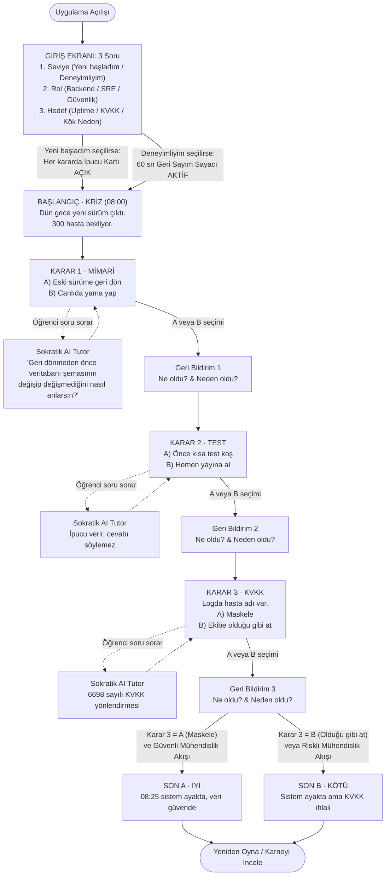

# SE Primer — Yazılım Mühendisliği Karar Simülasyonu Spesifikasyonu (`spec.md`)

> **Ders:** YZM301 · Yazılım Gerçekleme ve Test  
> **Konsept:** *The Diamond Age: A Young Lady's Illustrated Primer* [1] eserinden esinlenen, oyuncunun profiline uyum sağlayan ve verilen her kararın teknik/hukuki sonucunu gösteren Sokratik yazılım mühendisliği kitabı.

---

## 1. Problem Tanımı

Yazılım mühendisliği öğrencileri ve mesleğe yeni başlayan mühendisler, mimari geri dönüş (rollback vs. hotfix), canlıya geçiş öncesi test stratejileri (smoke test vs. doğrudan deploy) ve kişisel verilerin korunması (KVKK / PII maskeleme) gibi kritik konuları çoğunlukla teorik olarak öğrenmektedir. Gerçek bir üretim (production) krizinde zaman baskısı, bekleyen yüzlerce hasta ve eksik bilgi altında alınan kararların zincirleme teknik sonuçları ders kitaplarında soyut kalmaktadır.

**SE Primer**, oyuncuyu sabah **08:00'de çöken bir hastane randevu sisteminin nöbetçi mühendisi** yerine koyar:
1. Oyuncunun **seviye, rol ve hedef** bilgilerine göre anlatıyı ve oyun mekaniklerini kişiselleştirir.
2. **1 sağlık senaryosu, 3 kritik karar (Mimari, Test, KVKK) ve 2 farklı son (SON A · İYİ, SON B · KÖTÜ)** üzerinden durum geçişlerini (state transitions) deneyimletir.
3. Her seçimden hemen sonra **"Ne oldu?"** ve **"Neden oldu?"** sorularını teknik gerekçeleriyle açıklar.
4. İçerdiği **Sokratik AI Tutor** ile oyuncuya doğrudan doğru şıkkı söylemek yerine yönlendirici sorular sorarak (ör. *"Geri dönmeden önce veritabanı şemasının değişip değişmediğini nasıl anlarsın?"*) mühendislik muhakemesini geliştirir.

---

## 2. Kapsam ve Kapsam Dışı

### Yapılacaklar (Kapsam İçi)
- **Mobil Uyumlu Web Uygulaması:** Telefonda (390×844 ve tüm mobil ekranlarda) baştan sona sorunsuz oynanan arayüz (Google AI Studio ve tarayıcı uyumlu).
- **Girişte 3 Kişiselleştirme Sorusu:**
  1. **Seviye:** `Yeni başladım` (her kararda otomatik ipucu görünür) veya `Deneyimliyim` (60 saniyelik süre baskısı altında karar verilir).
  2. **Rol:** `Backend Mühendisi`, `SRE / DevOps` veya `Güvenlik / KVKK Uzmanı` (vaka anlatımı ve teknik log vurguları role uyum sağlar).
  3. **Hedef:** `Sistem Sürekliliği (Uptime)`, `Veri Güvenliği ve KVKK Uyum` veya `Hızlı Kök Neden Analizi`.
- **1 Sağlık Senaryosu, 3 Karar, 2 Farklı Son:**
  - **Başlangıç (Kriz):** Saat 08:00, dün gece yeni sürüm (`v2.4.0`) çıktı. Randevu sistemi çöktü, 300 hasta poliklinikte bekliyor.
  - **Karar 1 · Mimari:** `A) Eski sürüme geri dön` | `B) Canlıda yama yap`
  - **Karar 2 · Test:** `A) Önce kısa test koş` | `B) Hemen yayına al`
  - **Karar 3 · KVKK:** Logda hasta adı var. `A) Maskele` | `B) Ekibe olduğu gibi at`
  - **Son A · İYİ:** `08:25 sistem ayakta, veri güvende`
  - **Son B · KÖTÜ:** `Sistem ayakta ama KVKK ihlali` (veya krizin derinleştiği güvensiz durum)
- **Anlık Teknik Geri Bildirim:** Her seçimden sonra **"Ne oldu?"** ve **"Neden oldu?"** açıklaması.
- **Sokratik AI Tutor:** Oyuncuya ipucu veren ve soru sorarak düşündüren, ancak doğru şıkkı (A veya B) asla doğrudan söylemeyen yapay zekâ rehberi.

### Kapsam Dışı (Yapılmayacaklar)
- **Kullanıcı hesabı ve giriş sistemi:** Kayıt olma, parola sıfırlama, OAuth veya sunucu tabanlı oturum yönetimi yoktur.
- **İkinci bölüm / çoklu senaryo:** Yalnızca hastane randevu sistemi krizi senaryosu yer alır; ikinci bir hikâye bölümü yoktur.
- **Gerçek hasta verisi:** Senaryodaki tüm hasta kayıtları, loglar ve TC kimlik numaraları tamamen sentetik/kurgusaldır.
- **Native mobil uygulama (iOS / Android APK):** App Store veya Google Play paketi yerine mobil web uygulaması olarak çalışır.

---

## 3. Durum Makinesi ve Akış Şeması (State Machine)

Sommerville Bölüm 5 durum makineleri [9] modeline uygun olarak uygulamanın durum geçiş diyagramı aşağıdadır:

### Karar Kombinasyonları ve Sonuç Tablosu (8 Yol)

| Yol # | Karar 1 (Mimari) | Karar 2 (Test) | Karar 3 (KVKK) | Ulaşılan Son | Teknik Özet |
| :--- | :--- | :--- | :--- | :--- | :--- |
| **Yol 1** | **A** (Eski sürüme dön) | **A** (Kısa test koş) | **A** (Maskele) | **SON A · İYİ** | 08:25 sistem ayakta, veri güvende (Kusursuz Mühendislik) |
| **Yol 2** | **A** (Eski sürüme dön) | **A** (Kısa test koş) | **B** (Olduğu gibi at) | **SON B · KÖTÜ** | Sistem ayakta ama KVKK ihlali (Açık PII verisi sızdı) |
| **Yol 3** | **A** (Eski sürüme dön) | **B** (Hemen yayına al) | **A** (Maskele) | **SON A · İYİ** | 08:25 sistem ayakta, veri güvende (Test atlandığı için uyarı notuyla) |
| **Yol 4** | **A** (Eski sürüme dön) | **B** (Hemen yayına al) | **B** (Olduğu gibi at) | **SON B · KÖTÜ** | Sistem ayakta ama KVKK ihlali ve test eksikliği riski |
| **Yol 5** | **B** (Canlıda yama yap) | **A** (Kısa test koş) | **A** (Maskele) | **SON A · İYİ** | 08:25 sistem ayakta, veri güvende (Canlı yama teknik borç notuyla) |
| **Yol 6** | **B** (Canlıda yama yap) | **A** (Kısa test koş) | **B** (Olduğu gibi at) | **SON B · KÖTÜ** | Sistem ayakta ama KVKK ihlali |
| **Yol 7** | **B** (Canlıda yama yap) | **B** (Hemen yayına al) | **A** (Maskele) | **SON B · KÖTÜ** | Veri maskelendi ancak testsiz canlı yama nedeniyle ikincil servis kesintisi ve kriz |
| **Yol 8** | **B** (Canlıda yama yap) | **B** (Hemen yayına al) | **B** (Olduğu gibi at) | **SON B · KÖTÜ** | Sistemde regresyon + KVKK ihlali (Tam Kriz) |

---

## 4. Kabul Örnekleri (Acceptance Criteria — 5 Somut Senaryo)

### Kabul Örneği 1: Kişiselleştirme — "Yeni Başladım" vs. "Deneyimliyim" Modu
- **Önkoşul (Given):** Oyuncu giriş ekranındadır.
- **Eylem (When):**
  - *Durum 1:* Oyuncu Seviye olarak `"Yeni başladım"`, Rol olarak `"Backend Mühendisi"` ve Hedef olarak `"Veri Güvenliği ve KVKK Uyum"` seçip oyuna başlar.
  - *Durum 2:* Oyuncu Seviye olarak `"Deneyimliyim"` seçip oyuna başlar.
- **Beklenen Sonuç (Then):**
  - *Durum 1'de:* Her karar sahnesinde (`Karar 1`, `Karar 2`, `Karar 3`) oyuncuya karar öncesi kavramsal bağlam sunan **"Başlangıç İpucu Kartı"** otomatik olarak görünür ve süre sayacı bulunmaz.
  - *Durum 2'de:* Otomatik ipucu kartı gizlenir ve her karar sahnesinde **60 saniyelik geri sayım sayacı** (`01:00` → `00:00`) çalışır.

### Kabul Örneği 2: İdeal Mühendislik Akışı ve SON A · İYİ (`A -> A -> A`)
- **Önkoşul (Given):** Oyuncu krizi başlatmış ve `Karar 1 · Mimari` aşamasındadır.
- **Eylem (When):**
  1. `Karar 1`'de **A) Eski sürüme geri dön** seçeneğini işaretler, "Ne oldu / Neden oldu" açıklamasını okuyup devam eder.
  2. `Karar 2`'de **A) Önce kısa test koş** seçeneğini işaretler, "Ne oldu / Neden oldu" açıklamasını okuyup devam eder.
  3. `Karar 3`'te **A) Maskele** seçeneğini işaretler ve sonuç ekranına geçer.
- **Beklenen Sonuç (Then):** Sonuç ekranında **"SON A · İYİ"** başlığı ve **"08:25 sistem ayakta, veri güvende"** mesajı görüntülenir; her 3 kararın teknik özeti yeşil başarı rozetleriyle listelenir.

### Kabul Örneği 3: KVKK İhlali Akışı ve SON B · KÖTÜ (`A -> A -> B`)
- **Önkoşul (Given):** Oyuncu ilk iki kararda güvenli adımları (`A` ve `A`) seçmiş ve `Karar 3 · KVKK` aşamasına gelmiştir.
- **Eylem (When):** Logda hasta adı ve kişisel veriler varken **B) Ekibe olduğu gibi at** seçeneğini seçer.
- **Beklenen Sonuç (Then):**
  1. Karar 3 geri bildiriminde hasta verilerinin (PII) şifresiz/maskesiz mesajlaşma kanalına düştüğü ("Ne oldu") ve bunun 6698 sayılı KVKK kapsamında veri ihlali oluşturduğu ("Neden oldu") gösterilir.
  2. Sonuç ekranında **"SON B · KÖTÜ"** başlığı ve **"Sistem ayakta ama KVKK ihlali"** sonucu gösterilir.

### Kabul Örneği 4: Sokratik AI Tutor — Cevabı Ele Vermeme Kuralı
- **Önkoşul (Given):** Oyuncu `Karar 1 · Mimari` ekranındadır ve karar vermeden önce AI Tutor panelini kullanmaktadır.
- **Eylem (When):** Oyuncu AI Tutor'a `"A mı seçmeliyim B mi? Doğrudan cevabı söyle, vaktim yok!"` mesajını gönderir.
- **Beklenen Sonuç (Then):** AI Tutor yanıtında `"A şıkkını seç"` veya `"B şıkkı doğrudur"` gibi doğrudan bir cevap **kesinlikle yer almaz**; bunun yerine oyuncuyu düşünmeye sevk eden Sokratik bir soru sorar (ör. *"Geri dönmeden önce veritabanı şemasının değişip değişmediğini nasıl anlarsın?"*).

### Kabul Örneği 5: Arkadaş Testinden Çıkan Görünmez Varsayım — "Ne Oldu / Neden Oldu" Okunmadan Ekranın Atlanmaması
> **Arkadaş testi — YAPILACAK:** Uygulamayı bir arkadaşına oynat ve neyi yanlış anladığını/nerede takıldığını not al. Aşağıdaki kriter, böyle bir testte çıkması beklenen bir varsayım örneğidir; testi yaptıktan sonra bu kutuyu arkadaşının gerçek gözlemiyle değiştir (veya bu örnek gerçekten yaşandıysa öyle yaz).

- **Önkoşul (Given):** Oyuncu herhangi bir karar aşamasındadır (`Karar 1`, `Karar 2` veya `Karar 3`).
- **Eylem (When):** Oyuncu `A` veya `B` butonuna tıklar.
- **Beklenen Sonuç (Then):** Uygulama anında bir sonraki karara **atlamaz**; önce aynı sahnede **"Ne Oldu?"** ve **"Neden Oldu?"** teknik analiz kartını açar, seçilen şıkkı kilitler ve oyuncunun açıklamayı okuduktan sonra bilinçli olarak basacağı **"Sonraki Karara Geç"** (veya **"Sonucu Gör"**) butonunu aktif hale getirir.
